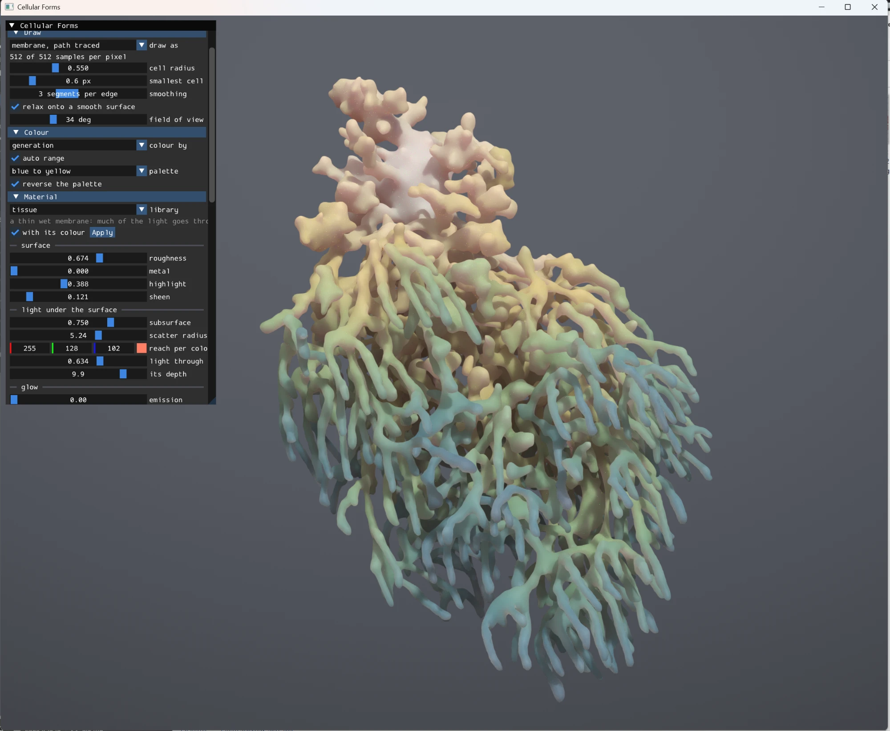

# Cellular Forms study

**[Cellular Forms Live](https://claude.ai/artifact/Xt2Grz2v3ZSKWjsbk6zKeT)**: grow forms in your browser (needs WebGPU and a free Claude account).

A reimplementation of Andy Lomas's "Cellular Forms": a closed sheet of cells that relaxes, grows
and divides, simulated on the GPU and viewed live. The
[slides](https://claude.ai/artifact/Jwuwcgqu99SH9iqRfS4Qaq#slide-92be4b748044) are the best
introduction to the project. `docs/design.md` is the design, `docs/model.md`
the model, `docs/progress/PROGRESS.md` the log of what was built and verified.

## How to run things

All commands are run from this folder, in PowerShell. The programs are in `build\release\bin`
once the project is built (see "Building" below; on this PC it is built).

### The viewer (desktop, Vulkan and Dear ImGui)

Grow a form live and change its parameters while it runs:

    build\release\bin\cf_view.exe --live

A few useful variations:

| Command | What it shows |
| --- | --- |
| `cf_view.exe --live --mode mesh --material skin` | Live, drawn as a membrane with the skin material |
| `cf_view.exe --live --mode pathmesh` | Live, path traced (needs a GPU with ray tracing) |
| `cf_view.exe --live --level 3 --seed 5 --param foodMax=0.01` | Another start, seed and parameter |
| `cf_view.exe --live --gallery 1530` | Form 1530 of the gallery grown again, pausing at the step it was pictured at; the G key opens the gallery to choose another |
| `cf_view.exe --snapshot runs\m2_default_100k\latest.cfs --mode mesh` | A saved state |
| `cf_view.exe --run runs\m2_default_100k --play` | A recorded run, played back |
| `cf_view.exe --snapshot <file> --screenshot out.png` | A picture, without a window |
| `cf_view.exe --help` | Every option; `--list-settings`, `--list-materials` |

In the window: drag with the left button to turn, with the right or middle button to move the
view, wheel to zoom; the panel on the left has the simulation, drawing, material, light and
output controls.

### In a headset (OpenXR: Meta Quest through Link, SteamVR)

    build\release\bin\cf_vr.exe

grows gallery form 5031 in front of you (`--gallery <id>` for another, `--mirror` to see the
left eye on the desktop, `--help` for the rest). Start Link (or SteamVR) first. Grip holds the
form (both grips also scale it), A runs or pauses, B starts it again, Y or the menu button opens
the menu, where the trigger clicks; its Gallery tab grows any form of the atlas.

### The viewer in a browser (WebGPU)

    python scripts\web_serve.py

then open http://localhost:8123/web/ . Or serve the `web` folder with any static server, for
example `python -m http.server` inside `web`, and open http://localhost:8000/ . The page is in
`web\app`; `web\README.md` says how to put it on a web server. (`web\check.html` is a check
for developers and needs data that is not in that folder.)

### The atlas (every run that was tried, with pictures, measures and ratings)

    python scripts\atlas serve

then open http://localhost:8765 . `python scripts\atlas --help` lists what else it does (survey,
kinds, early stop, searches, the web gallery). `python scripts\atlas native-gallery` writes
`runs\atlas\gallery\gallery.json`, the gallery of every form that the viewer's Gallery window shows (without it, the
viewer shows the web app's smaller gallery). On a phone the atlas is the private page
https://claude.ai/artifact/XQTS7vQHE4qMZv6HhtjKvG .

### Growing forms without a window

| Program | What it does |
| --- | --- |
| `cf_gpu.exe --new icosphere:2 --seed 1 --until-cells 100000 --out runs\mine` | Grows a form on the GPU (CUDA) and writes its states to a folder |
| `cf_run.exe` (same options) | The same on the CPU: the reference the GPU is checked against |
| `cf_describe.exe <state.cfs>` | The measures of a form, as one line of JSON |
| `cf_export.exe <state.cfs> --mesh form.ply` | A mesh or point cloud for Blender |
| `cf_bench.exe`, `cf_vkc.exe` | Benchmarks; the Vulkan compute port |

Each prints its options with `--help`. A state file made by one program opens in the others.

### Tests

    build\release\bin\cf_tests.exe
    build\release\bin\cf_cuda_tests.exe

## Building

Needs Visual Studio with the C++ tools, the CUDA toolkit and the Vulkan SDK. The first line
sets up the compiler for this PowerShell window; the second configures (only needed once, or
after a new file was added); the third builds.

    . .\scripts\vsenv.ps1
    cmake --preset release
    cmake --build --preset release

Third-party code is in `external\` as git submodules (`git submodule update --init` after a
fresh clone).
